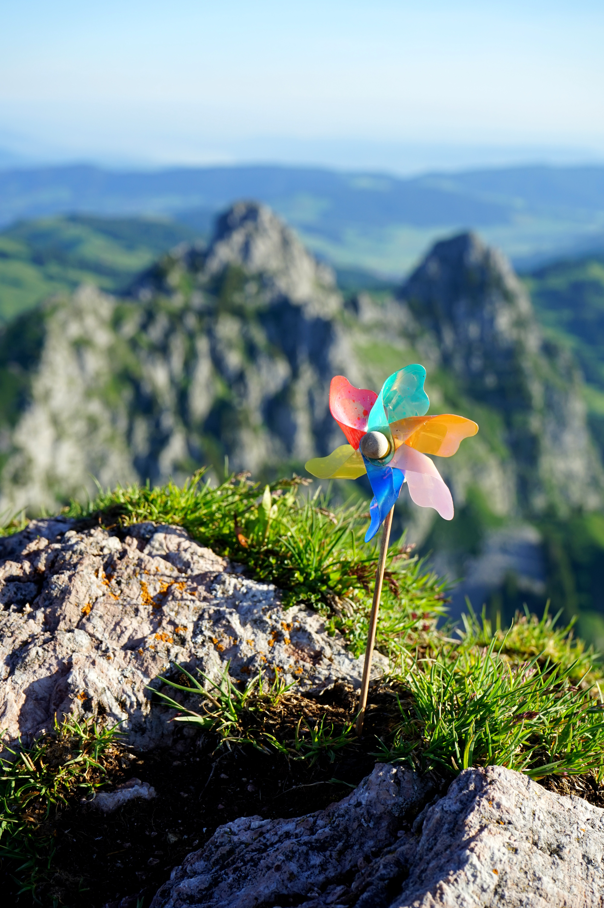

# Mid-Year Meetup — Placeholder Page Template

`nphti-mid-year-meetup.html` has been rebuilt with the full confirmed 2027 event (Hypnosis for Disorders of Gut-Brain Interaction, April 20, 2027). Before that event happens again next year, this page will need to go back to being a simple "thank you / check back soon" placeholder between events — this doc preserves that placeholder exactly as it stood, so swapping back is a straight copy-paste rather than a rebuild.

---

## Full placeholder markup (hero only — this was the entire page)

```html
<!-- ===== HERO ===== -->
<section class="hero">
  <div class="hero-inner">
    <div class="hero-grid">
      <span class="eyebrow"><span class="spark"></span> Training &middot; Mid-Year Meetup</span>
      <h1>NPHTI Mid-Year Meetup</h1>
      <p class="thanks">Thank you to the attendees and NPHTI faculty for making our 2026 Mid-Year Meetup a success!</p>
      <p>Check back soon for information on our 2027 Mid-Year Meetup, or visit the Workshops page to learn more about our 2026 Annual Workshops.</p>
      <span class="badge"><i></i> 2027 details coming soon</span>
      <div class="hero-ctas">
        <a class="btn btn-solid" href="nphti-annual-workshops.html">View the 2026 Annual Workshops</a>
      </div>
    </div>
    <div class="hero-photo">
      <svg class="shapes-mini" viewBox="0 0 200 200" aria-hidden="true">
        <polygon class="drift1" points="20,60 110,60 20,150" fill="#424c9a" opacity=".92"/>
        <polygon points="90,20 170,20 130,90" fill="#4da9bc" opacity=".9"/>
      </svg>
      <div class="backing" aria-hidden="true"></div>
      <div class="frame">
        
      </div>
    </div>
  </div>
</section>
```

## Full placeholder CSS

Everything the hero above needs — this is leaner than the full rebuilt page's stylesheet, since the placeholder has no fact-band, moderator cards, pricing, or closing CTA.

```css
:root{
  --purple:#424c9a; --teal:#3290a4; --lavender:#90a1d7; --aqua:#4da9bc;
  --paper:#f1f4fb; --paper-2:#e7ecf8; --white:#ffffff;
  --ink:#161b38; --mid:#5b618c; --line:#dbe1f4; --spark:#f2b134;
}
*{box-sizing:border-box;margin:0;padding:0;}
html{-webkit-text-size-adjust:100%;}
body{font-family:'DM Sans',sans-serif;font-weight:400;color:var(--ink);background:var(--paper);line-height:1.6;-webkit-font-smoothing:antialiased;}
.wrap{max-width:1080px;margin:0 auto;padding:0 clamp(20px,4vw,40px) clamp(48px,6vw,72px);}
a{color:inherit;}

.eyebrow{font-family:'DM Sans',sans-serif;font-weight:500;font-size:11px;letter-spacing:.2em;text-transform:uppercase;color:var(--teal);display:inline-flex;align-items:center;gap:9px;}
.eyebrow .spark{width:7px;height:7px;border-radius:50%;background:var(--spark);box-shadow:0 0 0 4px rgba(242,177,52,.18);}

:focus-visible{outline:2px solid var(--purple);outline-offset:3px;border-radius:5px;}

/* ===== HERO ===== */
.hero{position:relative;padding:clamp(40px,7vw,88px) 0 clamp(28px,4vw,48px);}
.hero-inner{display:grid;grid-template-columns:1fr 1fr;gap:clamp(32px,5vw,64px);align-items:center;}
@media(max-width:820px){.hero-inner{grid-template-columns:1fr;}}
.hero h1{font-family:'Bricolage Grotesque',sans-serif;font-weight:700;font-size:clamp(32px,5.4vw,52px);line-height:1.05;letter-spacing:-.02em;color:var(--ink);margin:18px 0 0;}
.hero p{color:var(--mid);font-size:clamp(16px,2vw,18px);max-width:480px;margin:18px 0 0;line-height:1.7;}
.hero p.thanks{color:var(--ink);font-weight:500;}
.hero-ctas{display:flex;gap:14px;flex-wrap:wrap;margin-top:30px;}
.btn{display:inline-flex;align-items:center;gap:8px;font-family:'DM Sans',sans-serif;font-weight:500;font-size:14px;padding:13px 22px;border-radius:9px;text-decoration:none;transition:transform .15s ease,background .15s ease,border-color .15s ease,color .15s ease;}
.btn-solid{background:var(--purple);color:#fff;}
.btn-solid:hover{background:#353f85;transform:translateY(-2px);}
.btn-outline{background:transparent;color:var(--ink);border:1.5px solid var(--line);}
.btn-outline:hover{border-color:var(--purple);color:var(--purple);transform:translateY(-2px);}

.hero-photo{position:relative;}
.hero-photo .shapes-mini{position:absolute;top:-34px;left:-30px;width:120px;height:120px;z-index:1;pointer-events:none;}
.hero-photo .shapes-mini .drift1{animation:drift1 7s ease-in-out infinite;}
@keyframes drift1{0%,100%{transform:translateY(0);}50%{transform:translateY(-8px);}}
@media(prefers-reduced-motion:reduce){.hero-photo .shapes-mini .drift1{animation:none;}}
.hero-photo .frame,.hero-photo .backing{clip-path:polygon(0 0,100% 0,100% 80%,82% 100%,0 100%);}
.hero-photo .backing{position:absolute;inset:0;z-index:1;background:var(--teal);transform:translate(16px,16px);}
.hero-photo .frame{position:relative;z-index:2;overflow:hidden;aspect-ratio:4/3;background:var(--white);}
.hero-photo .frame img{width:100%;height:100%;object-fit:cover;display:block;}
.hero-photo .frame::after{content:"";position:absolute;top:14px;right:14px;width:12px;height:12px;background:var(--spark);border-radius:2px;transform:rotate(45deg);}
@media(max-width:820px){.hero-photo{order:-1;max-width:340px;margin:0 auto;}.hero-photo .shapes-mini{display:none;}.hero-photo .backing{transform:translate(10px,10px);}}

.badge{display:inline-flex;align-items:center;gap:7px;font-size:12px;font-weight:500;letter-spacing:.03em;color:var(--ink);background:var(--white);border:1.5px solid var(--line);border-radius:20px;padding:7px 14px;margin-top:24px;}
.badge i{width:7px;height:7px;background:var(--spark);border-radius:50%;flex:0 0 auto;}
```

---

## Swap-back checklist, once the 2027 event has happened

1. Replace the full `<body>` content of `nphti-mid-year-meetup.html` with the hero markup above.
2. Replace the `<style>` block with the CSS above.
3. Update the "thank you" line to reference 2027 instead of 2026 (`Thank you to the attendees and NPHTI faculty for making our 2027 Mid-Year Meetup a success!`).
4. Update the badge to `2028 details coming soon` (or whatever the next cycle's year is) and the CTA button to point at that year's current Annual Workshops page/status.
5. Decide whether to swap the hero photo back to `images/single-pinwheel.jpg` or keep `images/2027-midyear.png`/commission a new generic image — the DGBI-specific photo won't make sense once the topic changes for the next meetup.
6. Update this doc's own filename/references once there's a new rebuilt-page version to preserve for the cycle after that.
